# 视频号打粉工作台

面向视频号内容整理、线索管理与沟通跟进的 Web 工作台。

本工作台将账号状态、内容采集、线索筛选、私信跟进与结果记录放在同一个界面中，
帮助使用者了解一条线索从内容发现到后续沟通的完整过程。
这份文档公开介绍产品页面与使用方式、业务流程与接口应用，如需获取演示系统，请查看下方的联系方式。

工作台支持使用你自己的本地网络出口连接微信，就像你本地登录了iPad微信一样。

相关项目：[公开接口文档（Control Plane API v1）](https://github.com/wechat-devp/-iPad-wechat-)。

> 本文截图来自实际产品的体验界面，账号、作品、线索、私信与统计均为虚构演示数据。
> 截图用于展示交互与页面组织方式，与生产运行验证或实际业务效果基本一致。

## 功能概览

| 模块 | 可以了解与使用的功能 |
| --- | --- |
| 工作台概览 | 查看账号概况、待处理事项及常用操作入口 |
| 微信账号 | 查看连接状态，进入添加账号流程和账号工作台 |
| 采集任务 | 按关键词或博主组织任务，查看任务状态与运行记录 |
| 作品库与评论监控 | 整理已采集的作品、浏览评论，管理需要持续关注的作品 |
| 线索与规则 | 查看线索来源、筛选结果、优先级与处理状态，维护筛选规则 |
| 活动与话术 | 组织活动与沟通内容，查看审核队列和发送记录 |
| 视频号私信 | 在收件箱中查看会话，记录跟进状态与沟通结果 |
| 来源与结果报表 | 从关键词、博主、话术或账号等维度查看已记录的数据 |

页面中的操作能力取决于账号授权、功能开放情况与实际使用环境。
任务完成、消息发送和沟通结果应以实际返回的状态及后续核实为准。

## 从哪里开始

1. **了解账号状态**：在微信账号页查看连接情况，按[微信登录流程](#微信登录流程图文)完成添加或重新登录。
2. **建立采集任务**：选择关键词或博主，设置需要关注的内容范围。
3. **查看作品与线索**：从任务结果进入作品、评论或线索列表，判断内容是否相关。
4. **整理沟通内容**：维护活动与话术，在需要审核的场景下先检查内容再确认。
5. **跟进会话**：在私信收件箱查看交流记录，补充跟进状态和结果标记。
6. **回看记录**：结合来源与结果报表，了解已记录的处理情况。

建议先熟悉页面中的状态含义，再逐步使用各项操作。
“已连接”“已提交”和“已完成”描述的是不同环节，应结合当前页面提示判断进度。

## 微信登录流程（图文）

以下以添加新账号、扫码登录为例：**添加账号 → 选择网络 → 手机微信扫码 → 验证助手 App 验证（如需）→ 手机确认登录 → 等待上线 → 进入工作台**。
截图展示 Web 端的操作与状态反馈；登录和验证二维码均为无法用于实际登录或验证的演示内容，无需扫描。
安全验证的两张配图使用占位二维码与模拟状态展示该分支的界面。

### 第一步：添加账号，选择连接方式

在左侧「微信账号」中点击「添加账号」，准备好已登录微信的手机。
按页面当前开放的选项选择连接方式，确认账号条件和网络要求后，点击「发起登录」。
下图以「直连」演示；使用新填的自定义代理时，须先按页面提示检测通过。

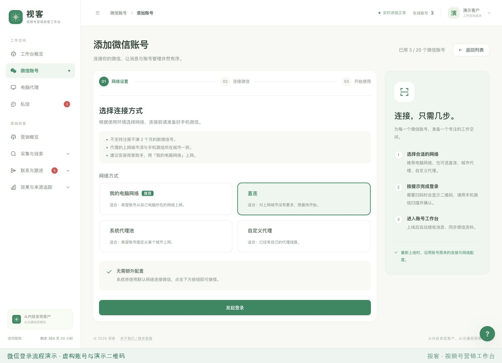

### 第二步：使用手机微信扫描登录二维码

发起登录后，页面会显示二维码及有效期。实际使用时，用准备好的手机微信扫描当前页面的登录二维码。
若提示二维码已过期，点击「刷新二维码」，再扫描新显示的二维码。

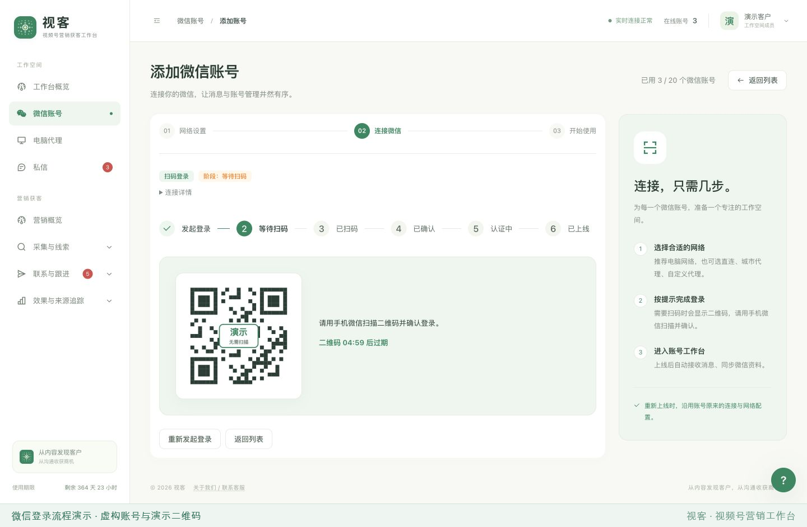

### 第三步：如提示进一步验证，使用验证助手 App 扫码

微信扫码成功后，如果提示需要进一步验证，Web 端会显示「微信要求额外安全验证」及一张新的验证二维码。
**此时须先完成验证，才能继续后续登录步骤。**

打开**验证助手 App**，使用其中的扫码功能扫描 Web 页面上新出现的验证二维码，并按 App 提示完成验证。
验证期间保留当前 Web 页面，等待验证结果自动更新。

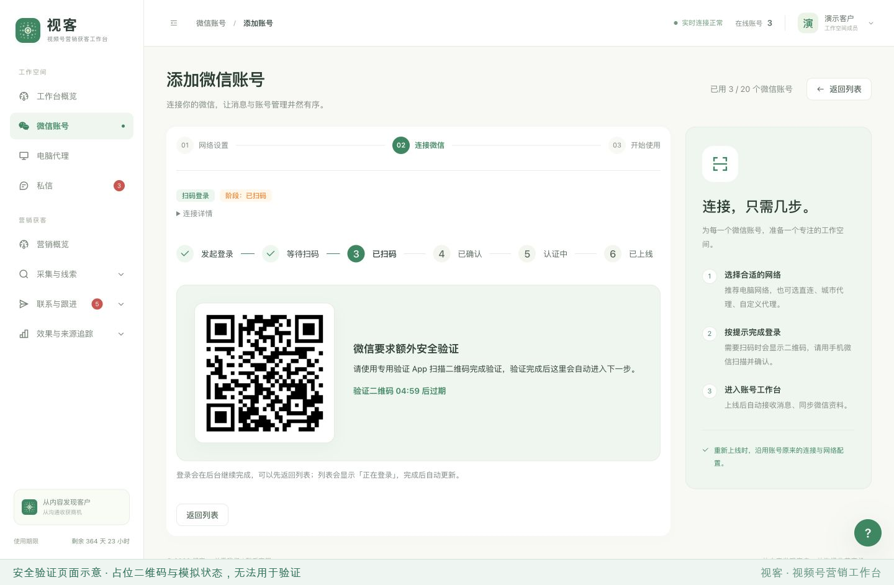

验证通过后，Web 端会显示「安全验证已完成」，随后继续更新登录进度。
安全验证完成后，仍需按后续提示完成手机确认及认证，直到账号上线。
如果本次登录未要求进一步验证，直接继续下一步。

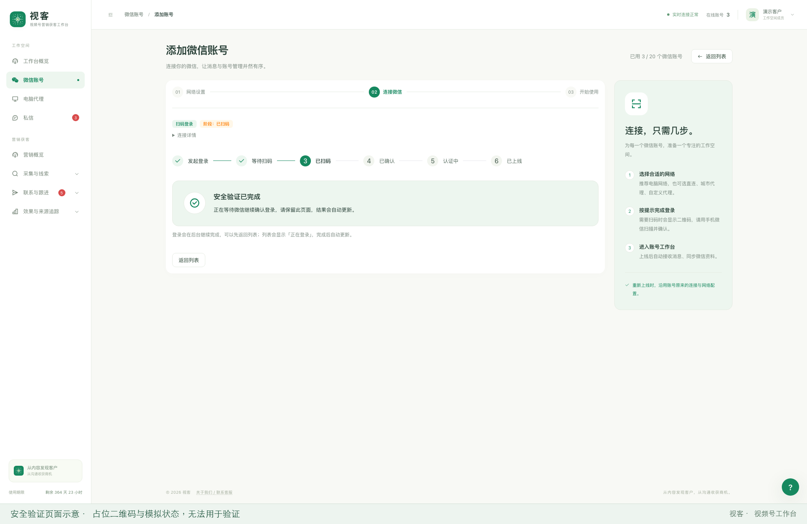

### 第四步：在手机上确认登录，等待认证

页面提示「扫码成功，请在手机上确认登录」时，还需要在手机微信的确认页点击「登录」。
随后 Web 端会自动更新为已确认、认证中等状态。认证可能需要数分钟，请等待状态更新，无需重复扫码或反复发起登录。

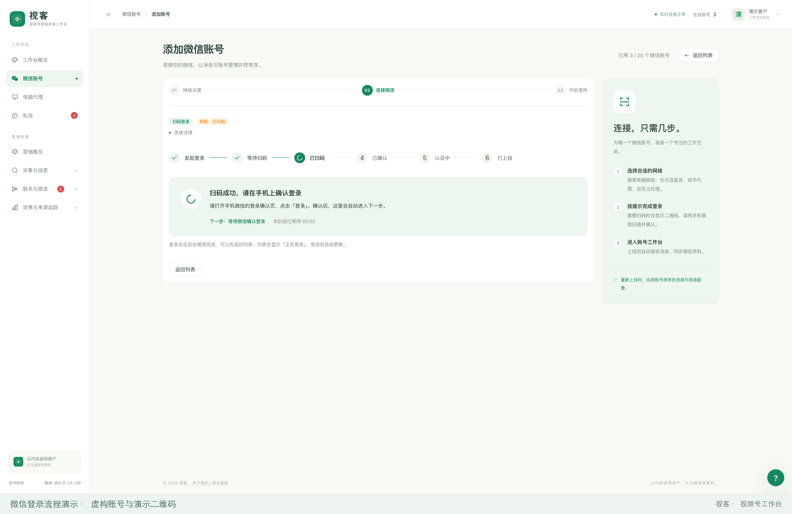

### 第五步：确认账号上线，进入工作台

看到「账号已上线，连接完成」后，点击「进入工作台」，即可查看该账号的可用功能与设置；
也可以返回账号列表查看连接状态。若仍提示「上线同步中」或「准备中」，等待同步完成后再进行操作。

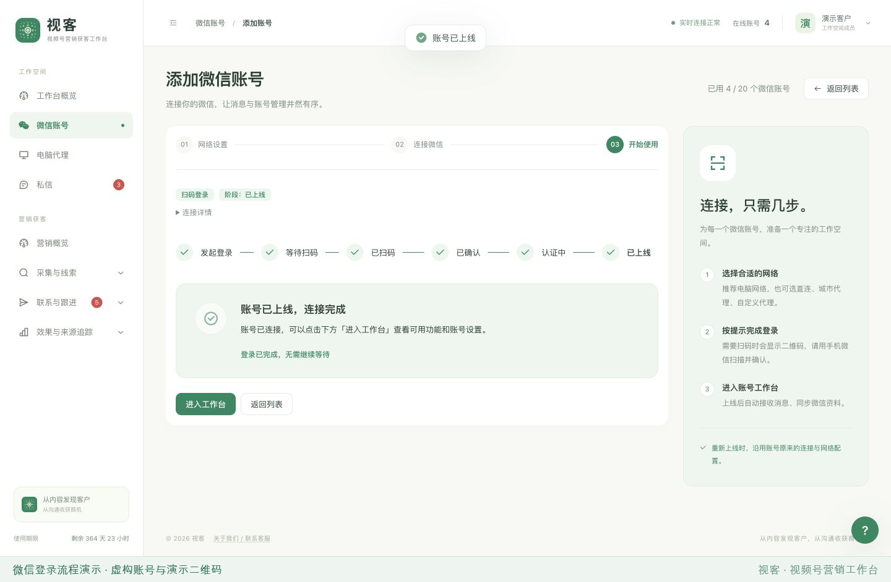

其他登录情况：

- **验证过期或失败**：按页面提示重新发起登录，再依次完成扫码及需要的验证。
- **登录失败**：根据页面原因检查网络或账号状态，再使用页面提供的重试入口。
- **重新上线**：从账号列表点击「重新上线」，按提示继续；是否需要扫码以实际流程为准。

## 页面展示

以下六张截图展示同一套虚构演示场景，便于连贯理解各个页面的关系。
画面中出现的数量、名称、消息与结果仅用于演示。

### 1. 工作台概览

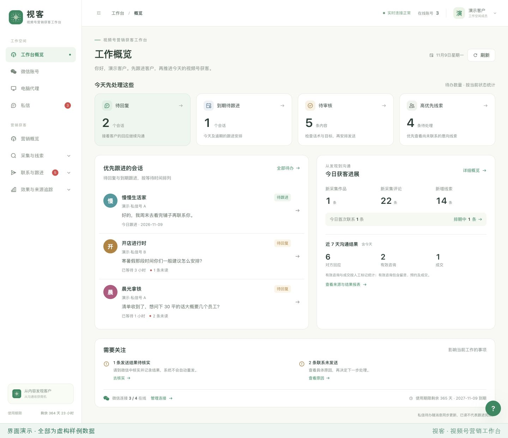

概览集中展示待回复、到期待跟进、待审核和高优先线索，并提供直达相应页面的入口。
会话待办与当天采集进展放在同一屏，便于安排下一步工作；结果待核实等事项单独提示。

### 2. 微信账号

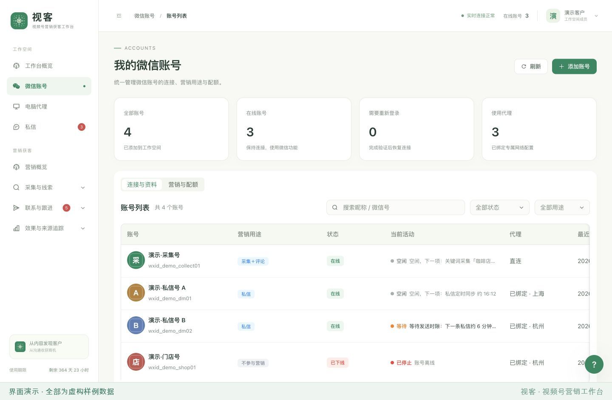

账号页集中展示连接状态、账号用途与最近在线时间，并提供添加账号、账号设置及工作台入口。
浏览器的实时连接状态与微信账号在线状态分别展示。添加账号与重新登录按页面提示操作，
是否需要扫码以实际流程为准。

### 3. 采集任务

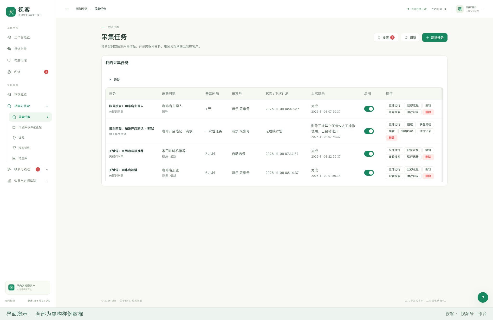

采集任务支持按关键词或博主组织内容，展示采集对象、执行账号、计划与最近运行结果。
可从任务进入相关线索和运行记录；作品库与评论监控用于继续查看作品、评论和信息来源。
支持多账号轮换采集，设置采集频率，采集时间段等

### 4. 线索管理

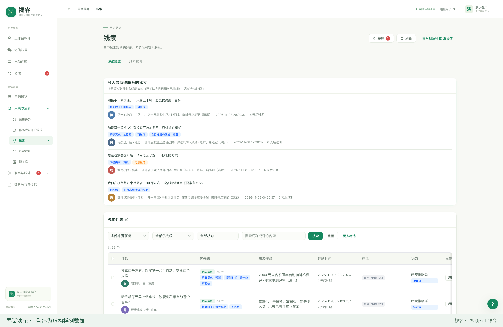

线索页展示评论或账号线索、来源、优先级与处理状态，并支持按来源任务、优先级和状态筛选。
可以查看原始内容、忽略不相关线索，或继续安排联系。推荐信息用于辅助判断，具体是否跟进由使用者决定。

### 5. 视频号私信收件箱

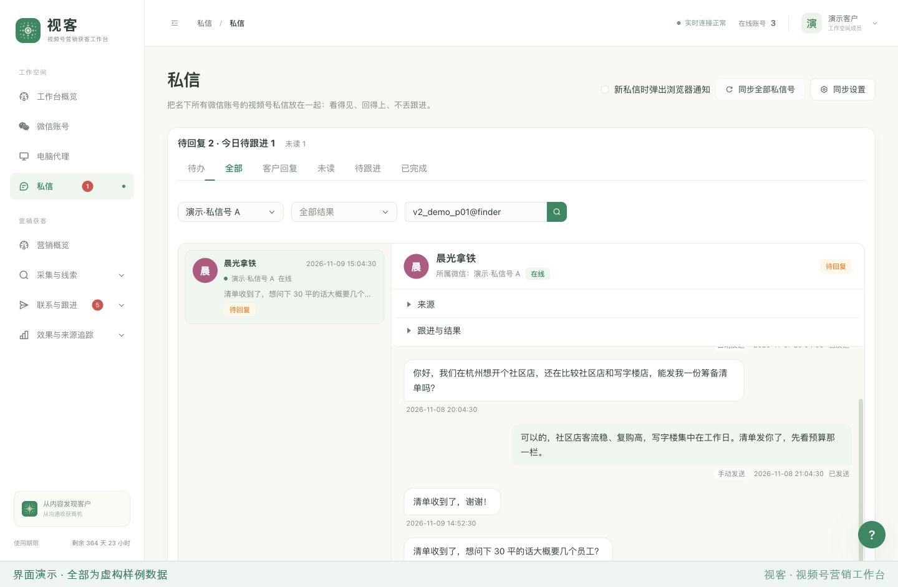

收件箱汇集名下账号的视频号私信，可按待办、未读、待跟进等状态查看会话，
并在同一页面阅读已保存的记录、回复消息、查看来源和记录沟通结果。
已读状态与跟进状态分开，方便区分“看过消息”和“完成跟进”。

### 6. 来源与结果报表

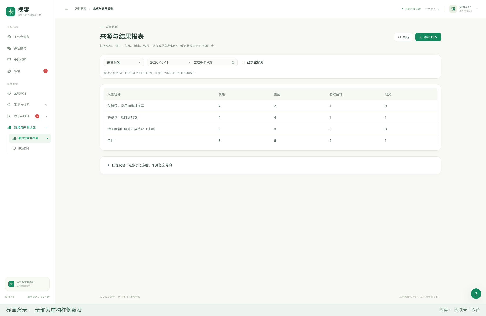

报表可按来源任务、关键词、博主、话术或账号等维度，查看联系、回应、有效咨询和成交等记录。
支持选择统计区间与导出 CSV；业务结果依赖相应的记录和标记，截图数字仅用于演示。

## 学习与使用说明

本文适合用于了解 Web 工作台的页面组织、操作流程、状态展示与结果记录方式。
实际使用时，应在拥有授权的账号与数据范围内操作，并尊重相关平台规则及他人意愿。
页面展示不构成对送达、时效、账号安全或业务效果的承诺。

如果希望进一步学习工作台所对接的基础服务接口，可阅读
[基础服务 API 公开参考文档](https://github.com/wechat-devp/-iPad-wechat-)。
其中说明的是基础服务的调用方式与接口约定；Web 页面介绍可以帮助理解这些能力的应用场景。

## 交流学习

欢迎交流接口应用、Web 界面设计、开发实践与技术学习。

Telegram：[@opencode666](https://t.me/opencode666)

也可扫描下方二维码联系：

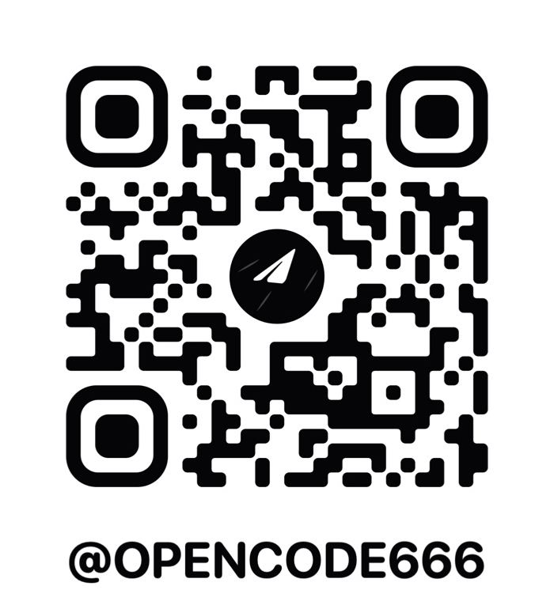
